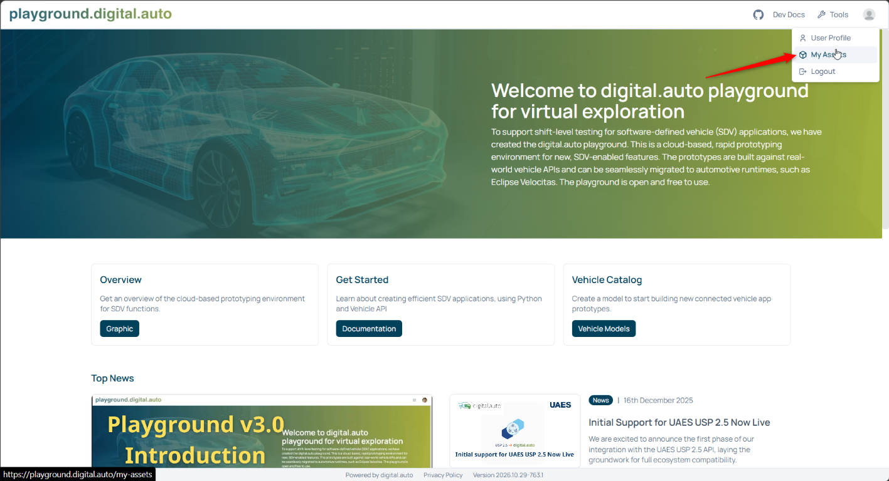
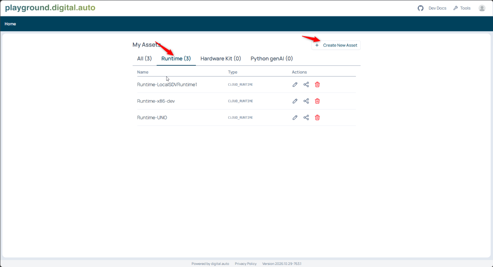
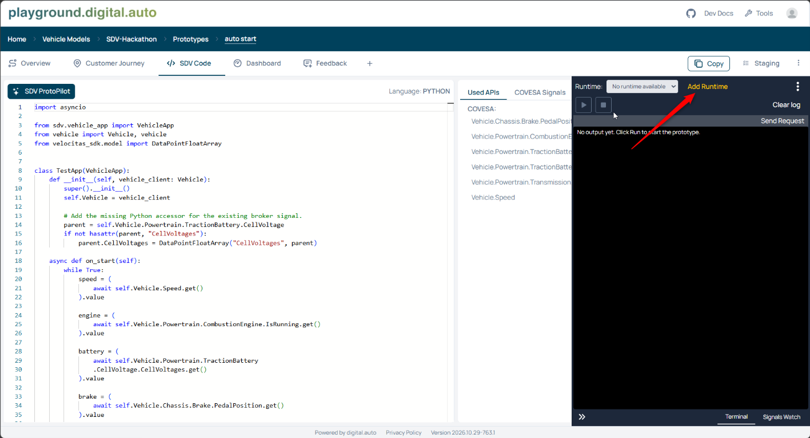
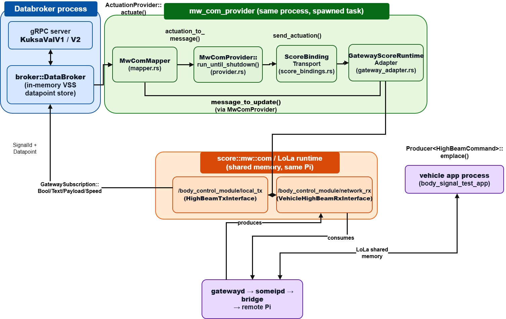

# sdv-hackathon-in-a-box

## Overview

This concept provides the overview of integrating the **SDV Runtime environment with Eclipse S-CORE middleware
on raspberry pi hardware**. In this project setup, HW-1(RPi-1) runs the SDV
Runtime environment container alongside the native SCORE middleware and Databroker(databroker-mw:provider).
The Runtime connects to the databroker; SCORE carries vehicle signals(VSS)
between the HW-1(RPi-1) and the HW-2(RPi-2).

HW-2 is the sensor(some/ip event publisher). It runs LED toggling application as well as provides the menu for publishing or testing the some/ip events.

On HW-1(RPi-1), the native SCORE middleware services consist of the communication (`mw::com`)
, `gatewayd`, `someipd`. And UDP bridge, and `score_app` runs as standalone. The SDV Runtime environment
runs in Docker on that same device and connects to the databroker.

**Velocitas app flow:**

```text
  Velocitas app -> KUKSA Client -> KUKSA Databroker-> mw::com -> gatewayd -> someipd -> UDP bridge -> network -> remote application -> remote signal state / GPIO LED

Feedback:
remote application -> network -> UDP bridge -> someipd -> gatewayd -> mw::com -> KUKSA Databroker -> KUKSA client -> Velocitas app
```

**`score_app` flow :**

```text
  score app-> mw::com -> gatewayd -> someipd -> UDP bridge -> network -> remote application -> remote signal state / GPIO LED

Feedback:
remote application -> network -> UDP bridge -> someipd -> gatewayd -> mw::com
  -> score_app
```


## Contents

- [Prerequisite](#prerequisite)
- [Prepare the host machine and RPi hardware](#prepare-the-host-machine-and-rpi-hw)
- [Set up RPi hardware](#setup-rpi-hw)
- [Build and package](#build-and-package)
- [Deploy and configure](#deploy-and-configure)
- [Demo](#demo)
- [Setup and run the SDV Runtime](#setup-and-run-the-sdv-runtime)
- [Playground use case](#playground-use-case)
- [Signal configuration and development](#signal-configuration-and-development)
- [Supported signals](#supported-signals)
- [Repository layout](#repository-layout)
- [Troubleshooting](#troubleshooting)

## prerequisite
Hardware : Raspberry pi 5 (64 bit Linux), LED , Switch 
Software Stack : SCORE , SDV Runtime 

```bash
git clone -b score-middlware https://github.com/goutham3108/sdv-hackathon-in-a-box-fork-.git
```

`Note`: Use dedicated Raspberry Pi 5 HW and a trusted WIFI network.

## Prepare the Host Machine and RPi HW

### prerequisites for host Machine
 build uses
[communication](communication/), [gateway](inc_someip_gateway/),
[KUKSA integration](kuksa-databroker/), and [baselibs](baselibs/) sources.

On a Debian/Ubuntu host machine:

```bash
sudo apt update
sudo apt install -y build-essential pkg-config libssl-dev python3 git curl \
  xz-utils rsync openssh-client file
```

Also install Host machine :

- **Bazelisk**, available as `bazel`, so each workspace uses its own
  `.bazelversion`. Follow the [Bazelisk installation instructions](https://github.com/bazelbuild/bazelisk#installation).
- **Rust through rustup**, following the [Rust installation instructions](https://www.rust-lang.org/tools/install).
  The KUKSA build requires stable Rust 1.96 or newer and adds the ARM64
  Rust target itself.
- **Docker Engine and Buildx**, following the
  [Docker installation instructions](https://docs.docker.com/engine/install/)
  and [Buildx setup](https://docs.docker.com/build/install-buildx/).

`Note` : After succesfull host setup it should show below details

```bash
bazel --version # any version
rustup update stable
rustup run stable rustc --version # any version
docker info
docker buildx version #any version 
```

### Prepare HW-1(RPi-1) and HW-2(RPi-2)

Run on **both hardware units**:

```bash
uname -m
sudo apt update
sudo apt install -y rsync openssh-server ca-certificates libstdc++6 \
  libgcc-s1 libc6 libatomic1 iproute2 procps util-linux
sudo systemctl enable --now ssh
```

### Download and prepare the ARM64 toolchain in host machine 

The [toolchain helper](inc_someip_gateway/tools/make_local_aarch64_toolchain.sh)
downloads [ARM GNU Toolchain 12.3.Rel1 for x86_64 targeting AArch64 Linux](https://developer.arm.com/-/media/Files/downloads/gnu/12.3.rel1/binrel/arm-gnu-toolchain-12.3.rel1-x86_64-aarch64-none-linux-gnu.tar.xz)
and copies headers and libraries from HW-1(RPi-1) to prepare a sysroot.

## setup RPI HW 
```bash
sudo apt update
sudo apt install -y build-essential libssl-dev
```
`NOTE`:(before running the toolchain)
1. Ensure HW-1(RPi-1) and HW-2(RPi-2) are on the same network and SSH is enabled.
1. Edit `PI_USER` and `PI_HOST` for HW-1 in the [toolchain helper](inc_someip_gateway/tools/make_local_aarch64_toolchain.sh).


```bash
cd ~/sdv-hackathon-in-a-box
nano inc_someip_gateway/tools/make_local_aarch64_toolchain.sh
bash inc_someip_gateway/tools/make_local_aarch64_toolchain.sh
"$HOME/aarch64_toolchain/toolchain/bin/aarch64-none-linux-gnu-g++" --version #any version
```

```bash
export AARCH64_TOOLCHAIN_ROOT="$HOME/aarch64_toolchain"
```

### Enable ARM64 Docker emulation

On the **Host Machine **, register ARM64 emulation:

```bash
docker run --privileged --rm tonistiigi/binfmt --install arm64
docker run --rm --platform linux/arm64 ubuntu:22.04 uname -m
```
## Build and Package

```bash
cd ~/sdv-hackathon-in-a-box
bash sdv-hack-demo/build-aarch64.sh 
bash sdv-hack-demo/package-aarch64.sh
```

| Output | Contents |
| --- | --- |
| `sdv-hack-demo/dist/vehicle-aarch64.tar.gz` | score app, score middleware, libraries, and SDV runtime environment image |
| `sdv-hack-demo/dist/remote-aarch64.tar.gz` | Remote application, configuration, and runtime dependencies |
| `sdv-hack-demo/dist/body-control-aarch64.tar.gz` | Separate standalone LoLa/KUKSA body-control example |


`Note`: If the native build succeeded but the Docker build failed, fix the reported
Docker error and retry only the runtime and packaging:

```bash
cd ~/sdv-hackathon-in-a-box
bash sdv-hack-demo/build-runtime-aarch64.sh 
bash sdv-hack-demo/package-aarch64.sh
```

`Note` : Do not package stale binaries or an old runtime image after a failed build.

## Deploy and Configure

For an existing installation, stop the running services before replacing files.

### Transfer the archives

```bash
cd ~/sdv-hackathon-in-a-box
scp sdv-hack-demo/dist/vehicle-aarch64.tar.gz USER-NAME@XX.YY.ZZ.AA:/tmp/   #HW1
scp sdv-hack-demo/dist/remote-aarch64.tar.gz USER-NAME@AA.BB.CC.DD:/tmp/    #HW2
```

`Note` :Replace `USER-NAME` and `IP's` with latest HW's.

### Extract Packages

these commands extracts and remove if any older deployment

**HW-1(RPi-1):**

```bash
gzip -t /tmp/vehicle-aarch64.tar.gz &&
  rm -rf ~/sdv-demo &&
  mkdir ~/sdv-demo &&
  tar -xzf /tmp/vehicle-aarch64.tar.gz -C ~/sdv-demo
```

**HW-2(RPi-2):**

```bash
gzip -t /tmp/remote-aarch64.tar.gz &&
  rm -rf ~/sdv-demo &&
  mkdir ~/sdv-demo &&
  tar -xzf /tmp/remote-aarch64.tar.gz -C ~/sdv-demo
```

### Set the HW addresses

On **both HW's**, edit the extracted file:

```bash
nano ~/sdv-demo/network.env
```

Save the same settings on both devices, using your actual addresses:

```bash
export SDV_VEHICLE_IP=XX.YY.ZZ.AA
export SDV_REMOTE_IP=AA.BB.CC.DD
export SDV_BRIDGE_UDP_PORT=35000
export SDV_REMOTE_UDP_PORT=35001
```

### Demo

On HW-2(RPi-2), open a terminal and execute:

```bash
~/sdv-demo/run/start-remote.sh
```

On HW-1(RPi-1), open a terminal and execute:

```bash
~/sdv-demo/run/start-vehicle.sh
```
`Note`: confirm below sotware services are started on HW-1 
```bash
top
```
 `someipd`, `gatewayd`, `udp_bridge`, `databroker-mw-com` ,`score_app` 


```bash
ss -ltnp 'sport = :55555'
cd ~/sdv-demo
./databroker-cli
```

At the CLI prompt, run:

```text
get Vehicle.Speed
```

The speed value is available after the remote publishes it. If the menu exits
or startup fails, check the [logs](#troubleshooting); background services
may still be running.

## Setup and Run the SDV Runtime

### Install Docker on HW-1(RPi-1)

For Raspberry Pi OS / Debian:

```bash
sudo apt update
sudo apt install -y docker.io curl
sudo systemctl enable --now docker
sudo docker info
```

`Note :`The commands below use `sudo` to avoid Docker-socket permission errors. If you prefer Docker access without `sudo`, run `sudo usermod -aG docker "$USER"` and log out and reconnect.
Docker group membership grants root-equivalent access.

### Load and start the container

Then run on **HW-1(RPi-1)**:

```bash
sudo docker load -i ~/sdv-demo/sdv-runtime-mw-com.tar &&
  test "$(sudo docker image inspect sdv-runtime:mw-com \
    --format '{{.Os}}/{{.Architecture}}')" = linux/arm64
```

For an **existing container**, stop and remove it before creating a replacement:

```bash
sudo docker stop sdv-runtime &&
  sudo docker rm sdv-runtime
```
Create a container from the docker image for a runtime.

```bash
sudo docker run -d \
  --name sdv-runtime \
  --pull never \
  --network=host \
  --ipc=host \
  -e RUNTIME_NAME=sdv-hackathon \
  sdv-runtime:mw-com
```
`NOTE:` RUNTIME_NAME can be changed to any name as you want for your applciation on playground 
if name is changed add the same runtime on [Playground.digital.auto](https://playground.digital.auto/).

### Use the Runtime in Playground.digital.auto

The container is started with `RUNTIME_NAME=sdv-hackathon`. Register a runtime
with that exact name in [Playground.digital.auto](https://playground.digital.auto/),
then keep the container running and connected to the syncer. The runtime
connects the playground prototype to the signals exposed by the vehicle
Databroker and middleware on HW-1(RPi-1).

There are two ways to register or attach the runtime:

1. **Create it from My Assets.** Sign in, open the account menu, select
   **My Assets**, then open the **Runtime** tab and choose **Create New Asset**.
   Create a runtime asset and use `sdv-hackathon` as its name.

   

   

2. **Add it from a prototype.** First create or open a vehicle model and create
   a prototype under that model. Open the prototype's **SDV Code** page and
   choose **Add Runtime**. Select the registered `sdv-hackathon` runtime.
   This is the alternative flow shown below.

   

After the runtime is registered, running, and selected for the prototype,
the prototype can use the vehicle signals exposed by this setup through
Playground. The available signals depend on the prototype's vehicle model and
the signals provided by the connected Databroker; this does not grant access
to every physical interface on HW-1.


## Playground Use Case

Open the project's [application on Playground.digital.auto](https://playground.digital.auto/model/6ac74f6058153433699fc828/library/prototype/6ac750b458153433699fcf5e/dashboard).
In its **Runtime** selector, choose the runtime created from this project's
SDV Runtime environment image (`sdv-hackathon`). Start the application running
on the SDV Runtime and increase vehicle speed above **110** on the remote app running on the HW-2(RPi-2). This triggers the
high-beam signal, which is reflected by the LED on HW-2(RPi-2). Signals and
feedback between the Playground application and HW-2(RPi-2) flow through the
SDV Runtime on HW-1(RPi-1) and the vehicle middleware.
The remote hardware uses these GPIO connections:

| Function | BCM GPIO | Physical pin |
| --- | --- | --- |
| high-beam switch input | 17 | 11 |
| High-beam indicator LED output | 27 | 13 |

## Signal Configuration and Development

The [body manifest](sdv-hack-demo/config/body_signals.json) defines body routes,
types, VSS paths, and event IDs. The [generator](sdv-hack-demo/configure_signals.py)
updates the gateway/LoLa/vsomeip configuration, route file, communication
example declarations, and KUKSA provider bindings.

After editing the manifest, run on the **host machine**:

```bash
cd ~/sdv-hackathon-in-a-box
python3 sdv-hack-demo/configure_signals.py --write
python3 sdv-hack-demo/configure_signals.py
python3 sdv-hack-demo/configure_signals_test.py
```

The second command checks generated snapshots without writing them.
Rebuild and redeploy both packages after configuration changes.

### Add a signal to the existing body service

1. Add a manifest entry with a unique `apiName`, `name`, and even
   `vehicleEvent`. Supported wire types are `boolean`, `uint8`, `int16`,
   `float`, `float_array`, and `string`. Arrays also need `maxElements` from
   1 to 8.
2. Choose its provider direction: `sensor` is receive-only, `actuator` is
   command-only, and an omitted `type` is bidirectional.
3. Check codecs and values in the [remote sweep helpers](sdv-hack-demo/remote_app/test_payloads.h),
   [vehicle test helpers](sdv-hack-demo/vehicle_app/signal_test_values.h), and
   [provider sample conversion](kuksa-databroker/mw_com_provider/src/gateway_samples.rs).
4. Add an SDK overlay definition if the property is not already in the
   generated vehicle model.
5. Regenerate, test, build, and deploy matching archives.

The bridge and remote share one [UDP framing library](sdv-hack-demo/include/high_beam_udp_protocol.h).
Frames are 46 bytes, with at most 32 payload bytes.

### Add a new SOME/IP service

The body generator is specific to service `0x4300`, instances `0x1000` /
`0x1001`, and paired command/feedback event IDs. A new service requires
coordinated changes, not just another row in the body manifest:

| Area | Required agreement |
| --- | --- |
| Generator and provider bindings | Service, instance, member, direction, and VSS type |
| Gateway and LoLa manifests | Interfaces, identifiers, sample layout, and serializers |
| SOME/IP / vsomeip configuration | Service/version, instance, event, and eventgroup IDs |
| Route file and remote behavior | Matching numeric IDs and payload encoding |
| Build and package scripts | All required binaries, configurations, and libraries |
| Runtime model | SDK property and broker datatype |

For detailed layouts and configuration ownership, see [ARCHITECTURE.md](ARCHITECTURE.md).

### Host regression tests

Run on the **host machine**:

```bash
cd ~/sdv-hackathon-in-a-box
cd inc_someip_gateway
bazel test --config=sdv-demo --package_path="%workspace%:.." \
  //sdv-hack-demo:high_beam_udp_protocol_test \
  //sdv-hack-demo:speed_payload_test \
  //sdv-hack-demo/bridge:service_registration_test \
  //sdv-hack-demo/remote_app:high_beam_command_test \
  //sdv-hack-demo/vehicle_app:signal_test_values_test
```

Host unit tests and a successful build do not replace deployment verification.

## Supported Signals

The tables list **transport types**. Brake and oil-temperature values are
converted between their transport and broker datatypes.

### Bidirectional body signals

These 37 mappings accept actuator commands and receive current values.

| VSS path | Wire type |
| --- | --- |
| `Vehicle.Body.Lights.Beam.High.IsOn` | boolean |
| `Vehicle.Body.Horn.IsActive` | boolean |
| `Vehicle.Body.Lights.IsHighBeamSwitchOn` | boolean |
| `Vehicle.Body.Lights.Parking.IsOn` | boolean |
| `Vehicle.Body.Lights.Running.IsOn` | boolean |
| `Vehicle.Body.Lights.Fog.Front.IsOn` | boolean |
| `Vehicle.Body.Lights.Fog.Rear.IsOn` | boolean |
| `Vehicle.Body.Lights.Hazard.IsSignaling` | boolean |
| `Vehicle.Body.Lights.DirectionIndicator.Left.IsSignaling` | boolean |
| `Vehicle.Body.Lights.DirectionIndicator.Right.IsSignaling` | boolean |
| `Vehicle.Body.Lights.Brake.IsActive` | boolean |
| `Vehicle.Body.Hood.IsOpen` | boolean |
| `Vehicle.Body.Trunk.Rear.IsOpen` | boolean |
| `Vehicle.Body.Trunk.Rear.IsLocked` | boolean |
| `Vehicle.Body.Trunk.Rear.Position` | uint8 |
| `Vehicle.Body.Mirrors.DriverSide.IsFolded` | boolean |
| `Vehicle.Body.Mirrors.PassengerSide.IsFolded` | boolean |
| `Vehicle.Body.Mirrors.DriverSide.IsHeatingOn` | boolean |
| `Vehicle.Body.Mirrors.PassengerSide.IsHeatingOn` | boolean |
| `Vehicle.Body.Windshield.Front.Wiping.Mode` | string |
| `Vehicle.Body.Windshield.Front.Wiping.Intensity` | uint8 |
| `Vehicle.Body.Windshield.Front.WasherFluid.Level` | uint8 |
| `Vehicle.Body.Windshield.Front.WasherFluid.IsLevelLow` | boolean |
| `Vehicle.Body.Raindetection.Intensity` | uint8 |
| `Vehicle.Body.Windshield.Front.IsHeatingOn` | boolean |
| `Vehicle.Body.Windshield.Rear.IsHeatingOn` | boolean |
| `Vehicle.Cabin.Door.Row1.DriverSide.IsLocked` | boolean |
| `Vehicle.Cabin.Door.Row1.DriverSide.IsOpen` | boolean |
| `Vehicle.Cabin.Door.Row1.DriverSide.Window.Position` | uint8 |
| `Vehicle.Cabin.Door.Row1.DriverSide.IsChildLockActive` | boolean |
| `Vehicle.Cabin.Door.Row1.PassengerSide.IsLocked` | boolean |
| `Vehicle.Cabin.Door.Row1.PassengerSide.IsOpen` | boolean |
| `Vehicle.Cabin.Door.Row1.PassengerSide.Window.Position` | uint8 |
| `Vehicle.Cabin.Door.Row2.DriverSide.IsLocked` | boolean |
| `Vehicle.Cabin.Door.Row2.DriverSide.IsOpen` | boolean |
| `Vehicle.Cabin.Door.Row2.PassengerSide.IsLocked` | boolean |
| `Vehicle.Cabin.Door.Row2.PassengerSide.IsOpen` | boolean |

### Receive-only body and powertrain signals

| VSS path | Wire type |
| --- | --- |
| `Vehicle.Powertrain.CombustionEngine.IsRunning` | boolean |
| `Vehicle.OBD.OilTemperature` | int16 |
| `Vehicle.Powertrain.TractionBattery.CellVoltage.CellVoltages` | float_array, up to 8 values |
| `Vehicle.Acceleration.Vertical` | float |
| `Vehicle.Chassis.Brake.PedalPosition` | uint8 |
| `Vehicle.Powertrain.FuelSystem.IsEngineStopStartEnabled` | boolean |

### Transmission and speed

| VSS path | Type and direction |
| --- | --- |
| `Vehicle.Powertrain.Transmission.PerformanceMode` | String; command-only provider mapping |
| `Vehicle.Speed` | Float in the broker, double on the wire; receive-only provider mapping |

## Repository Layout

| Location | Purpose |
| --- | --- |
| [sdv-hack-demo](sdv-hack-demo/) | Demo applications, shared UDP protocol, signal generation, build and deployment scripts |
| [inc_someip_gateway](inc_someip_gateway/) | SOME/IP daemon, gateway, serializers, and toolchain helper |
| [communication](communication/) | S-CORE mw::com interfaces and examples |
| [kuksa-databroker](kuksa-databroker/) | Databroker, CLI, and mw::com provider integration |
| [baselibs](baselibs/) | Shared dependencies used by the integration |
| [patch](patch/) | Runtime integration patch and local runtime build checkout |
| [ARCHITECTURE.md](ARCHITECTURE.md) | Transport layouts, identifiers, and architecture details |
| [LICENSE](LICENSE) | Repository license |

### Architecture diagrams





## Troubleshooting

Vehicle logs are `someipd.log`, `gatewayd.log`, `bridge.log`, and `kuksa.log`
in the vehicle installation directory:

```bash
tail -f ~/sdv-demo/someipd.log ~/sdv-demo/gatewayd.log \
  ~/sdv-demo/bridge.log ~/sdv-demo/kuksa.log
```

The menus log to their foreground terminals. To record remote output, use
this **instead of** its normal launch:

```bash
~/sdv-demo/run/start-remote.sh 2>&1 | tee ~/sdv-demo/remote_app.log
```

| Problem | Check / action |
| --- | --- |
| `SDV_VEHICLE_IP: unbound variable` | Save all four `SDV_*` network settings in the extracted installation's `network.env`. |
| Docker socket permission denied | Use `sudo docker`, or reconnect after adding your user to the Docker group. |
| Docker `exec format error` during ARM64 build | Verify ARM64 emulation on the host machine before retrying the image build. |
| Image archive not found | Build the runtime, package again, and use the actual extracted vehicle directory. |
| Missing `databroker-mw-com` or CLI during packaging | Complete the KUKSA ARM64 build; the gateway Bazel build does not produce these executables. |
| `Baselibs checkout missing` | Check that `baselibs/score/log_rust/score_log/Cargo.toml` exists in the full workspace. |
| Another instance / occupied port | Stop the old deployment and identify the process holding the port before restarting. |
| Vehicle menu exits before displaying options | Check the foreground error and that its instance specifiers match the deployed manifest. |
| Broker value unavailable | Publish from the remote first, then check bridge, gateway, and provider logs. PerformanceMode has no feedback mapping. |
| SDK speed is zero while CLI speed is correct | Check that the corrected provider configuration and rebuilt runtime image are deployed together. |
| Missing SDK trunk/mirror/cell-voltage property | Rebuild the runtime with the overlay and recreate the container. |
| Missing shared libraries | Use the complete archive and its launcher; preserve the packaged runfiles and both serializer libraries. |
| Kit Manager healthy but no signal updates | Check native CLI feedback and syncer connection logs separately. |

For communication failures, check listeners and the high-beam-switch route:

```bash
ss -lunp
grep -E 'high_beam_switch|8436|8437' \
  ~/sdv-demo/bridge.log ~/sdv-demo/someipd.log ~/sdv-demo/gatewayd.log | tail -n 80
```

The switch route uses forward event `0x8436` and return event `0x8437`.
Trace reception from bridge to someipd to gatewayd to the provider.
A bridge `notify()` log alone does not establish that the subscriber received
the event. For IPC connection errors, stop the stack and restart remote first,
then vehicle.
