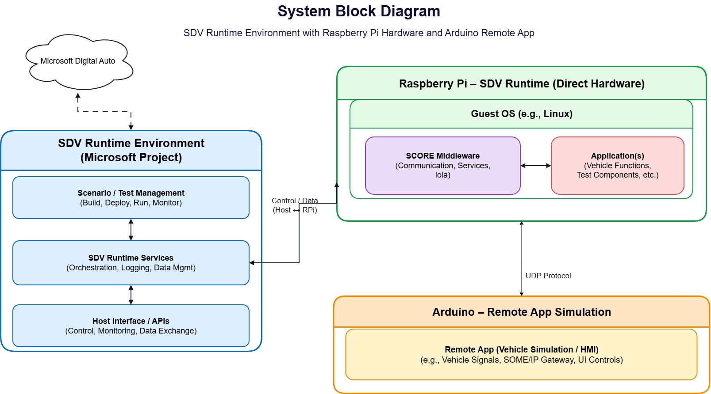
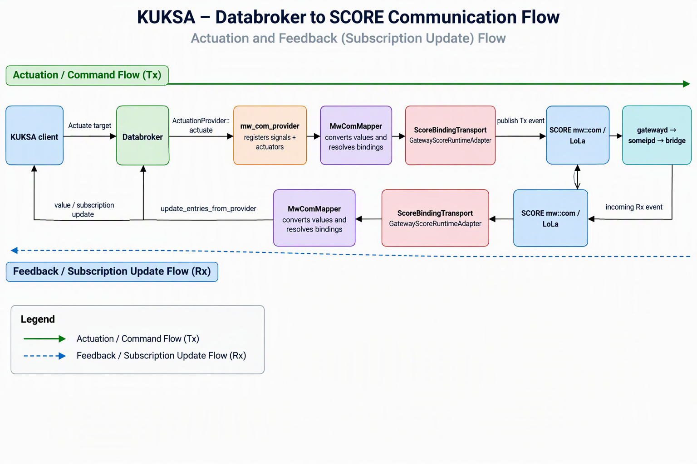

# sdv-hackathon-in-a-box

> Draft: existing two-Pi demo instructions plus SDV Runtime image deployment on vehicle Pi 1. The integrated build applies the patch on the build host; the full image build and on-Pi runtime connection still require validation in your environment.

## Overview

This demo exchanges VSS signals between two Raspberry Pis. The vehicle Pi runs KUKSA Databroker, Eclipse S-CORE mw::com shared memory, a SOME/IP gateway, and a UDP bridge. The remote Pi runs a UDP application with a keyboard menu, GPIO switch, and LED.

The vehicle application provides a menu for high-beam commands and speed values. By default, high-beam commands use KUKSA VAL v2 actuation, and the KUKSA provider is the sole body-signal mw::com Tx publisher. The remote reports application state back to the vehicle. **A queued command, returned application feedback, and physical actuator operation are not equivalent.** UDP delivery is best-effort.

## Contents

- [Quick start](#quick-start)
- [SDV Runtime on vehicle Pi 1](#sdv-runtime-on-vehicle-pi-1)
- [Prerequisites](#prerequisites)
- [Operating modes](#operating-modes)
- [Network configuration](#network-configuration)
- [Menus and verification](#menus-and-verification)
- [GPIO wiring and safety](#gpio-wiring-and-safety)
- [Test all 44 signals](#test-all-44-signals)
- [Signals and configuration](#signals-and-configuration)
- [Logs and troubleshooting](#logs-and-troubleshooting)
- [Stop the demo](#stop-the-demo)
- [Architecture](#architecture)
- [Project files](#project-files)
- [Developer guide](#developer-guide-add-a-someip-signal-or-service)
- [Currently supported VSS signals](#currently-supported-vss-signals)

## Quick Start

Use an isolated test rig. Complete the [prerequisites](#prerequisites) and read the [GPIO safety instructions](#gpio-wiring-and-safety) first; the build requires the full workspace, a configured ARM64 toolchain, and the separately supplied KUKSA integration checkout.

### Build, deploy, and run

Follow these steps for a new or existing deployment. Examples use vehicle Pi `10.187.243.101` and remote Pi `10.187.243.79`; replace addresses and SSH accounts for your network. For a first deployment, skip the stop step and omit removal of an old container.

**1. Existing deployment: [stop the runtime and native services](#stop-the-demo).**

This procedure replaces the deployment without backups. Old deployment state and container-only files, including a manually added application, will be lost. Verify TCP port `55555` is no longer owned by the old broker before starting the replacement.

**2. Build host: rebuild and package, starting from the repository root.**

```bash
bash sdv-hack-demo/build-aarch64.sh && \
  bash sdv-hack-demo/package-aarch64.sh
```

The build regenerates provider types, builds the native stack and remote app, rebuilds the ARM64 runtime model, and runs its typed SDK checks. Packaging embeds `patch/sdv-runtime/sdv-runtime-mw-com.tar` in the vehicle archive and also creates remote and standalone body-control archives. Do not deploy after a failed build or package operation.

**3. Build host: transfer both archives.**

```bash
scp sdv-hack-demo/dist/vehicle-aarch64.tar.gz <vehicle-user>@10.187.243.101:/tmp/
scp sdv-hack-demo/dist/remote-aarch64.tar.gz <remote-user>@10.187.243.79:/tmp/
```

For a localhost-forwarded vECU, use `scp -P 2222 sdv-hack-demo/dist/vehicle-aarch64.tar.gz pi@localhost:/tmp/`. Confirm new SSH host fingerprints through a trusted channel and enter passwords directly in the terminal.

**4. Vehicle Pi: verify and extract the vehicle archive.**

The commands below delete the old deployment before extracting the replacement.

```bash
gzip -t /tmp/vehicle-aarch64.tar.gz &&
  rm -rf ~/sdv-demo &&
  mkdir ~/sdv-demo &&
  tar -xzf /tmp/vehicle-aarch64.tar.gz -C ~/sdv-demo
```

**5. Remote Pi: verify and extract the remote archive.**

```bash
gzip -t /tmp/remote-aarch64.tar.gz &&
  rm -rf ~/sdv-demo &&
  mkdir ~/sdv-demo &&
  tar -xzf /tmp/remote-aarch64.tar.gz -C ~/sdv-demo
```

**6. Both Pis: edit `~/sdv-demo/network.env` to contain the same peer addresses.**

```bash
nano ~/sdv-demo/network.env
```

For example:

```bash
export SDV_VEHICLE_IP=10.187.243.101
export SDV_REMOTE_IP=10.187.243.79
export SDV_BRIDGE_UDP_PORT=35000
export SDV_REMOTE_UDP_PORT=35001
```

These lines must be saved in the file, not just entered in the terminal.

**7. Start the remote, then the native vehicle stack in separate foreground terminals.**

Remote Pi:

```bash
~/sdv-demo/run/start-remote.sh
```

Vehicle Pi:

```bash
~/sdv-demo/run/start-vehicle.sh
```

The default vehicle mode starts someipd, gatewayd, the bridge, and KUKSA in the background, then the vehicle menu in the foreground. Allow about two minutes for broker readiness. The remote app handles UDP directly; no remote gateway or SOME/IP daemon is started.

**8. Vehicle Pi, second terminal: load the new image and recreate the container.**

Install Docker first if needed using [Docker setup](#docker-setup-on-pi-1). Confirm the native broker is listening before continuing:

```bash
ss -ltnp | grep ':55555'
```

The old container must already be stopped. Remove it using its actual name or ID; below assumes `sdv-runtime`. On a first launch, omit the `docker rm sdv-runtime &&` line.

```bash
docker load -i ~/sdv-demo/sdv-runtime-mw-com.tar &&
  test "$(docker image inspect sdv-runtime:mw-com \
    --format '{{.Os}}/{{.Architecture}}')" = linux/arm64 &&
  docker rm sdv-runtime &&
  docker run -d \
    --name sdv-runtime \
    --pull never \
    --network=host \
    --ipc=host \
    -e RUNTIME_NAME=x86-dev \
    sdv-runtime:mw-com &&
  docker logs -f sdv-runtime
```

Proceed only if image loading and the architecture check succeed. Ctrl-C stops following logs, not the container. Merely restarting the old container does not install the new Python model.

**9. Vehicle Pi: verify ordinary SDK reads, not only the diagnostic monitor.**

```bash
docker exec -i -w /home/dev \
  -e PYTHONPATH=/home/dev/python-packages sdv-runtime python3 - <<'PY'
import asyncio
from vehicle import vehicle
from velocitas_sdk.vdb.client import VehicleDataBrokerClient

paths = [
    "Vehicle.Speed",
    "Vehicle.Body.Lights.Brake.IsActive",
    "Vehicle.OBD.OilTemperature",
    "Vehicle.Body.Trunk.Rear.Position",
    "Vehicle.Body.Mirrors.DriverSide.IsFolded",
    "Vehicle.Body.Mirrors.PassengerSide.IsFolded",
    "Vehicle.Powertrain.TractionBattery.CellVoltage.CellVoltages",
]

async def main():
    client = VehicleDataBrokerClient()
    try:
        for path in paths:
            node = vehicle
            for name in path.split(".")[1:]:
                node = getattr(node, name)
            print(path, repr((await node.get()).value), flush=True)
    finally:
        await client.close()

asyncio.run(main())
PY
```

Initially some signals may be unavailable until the remote publishes them. Publish speed using remote option `2`; the SDK must return that value rather than zero. Start your monitor before remote option `4`, then allow about 12 minutes for the full sweep and rerun the SDK check. Brake state now reads `INACTIVE`/`ACTIVE`, corresponding to remote `false`/`true`. The four previously missing properties must no longer raise `AttributeError`. PerformanceMode remains actuator-only and is excluded from feedback verification.

If you add a new application at `/home/dev/main.py` inside the replacement container, run it with:

```bash
docker exec -it -w /home/dev \
  -e PYTHONPATH=/home/dev/python-packages \
  sdv-runtime python3 -u main.py
```

The earlier diagnostic monitor reads protobuf fields directly. Its successful output alone does not validate the typed SDK; use the ordinary `.get()` check above as well. If your application writes signals rather than being a read-only monitor, review its behavior before running it on the test rig.

### Additional verification

On the remote menu, select `3` and enter `true`, then `false`. Parking lights are software state only; no GPIO is assigned to them.

**Vehicle Pi, second terminal, working directory: `~/sdv-demo`:**

```bash
cd ~/sdv-demo
./databroker-cli --server http://127.0.0.1:55555 get Vehicle.Body.Lights.Parking.IsOn
```

The current value should follow the remote selection. This checks application feedback, not physical actuation. For outbound high beam, use vehicle menu option `1`; verify remote reception, LED output where available, and returned current value separately. See [menus and verification](#menus-and-verification).

## SDV Runtime on Vehicle Pi 1

### Recommended build location

Build the ARM64 image on the build host, export it, and load it on Pi 1. This avoids compiling Python and Node dependencies on a resource-constrained Pi and allows one image to be reused. Docker Engine and Buildx must already be installed and accessible to your account. An x86_64 build host needs working ARM64 emulation or a native ARM64 builder. See the [Docker multi-platform guide](https://docs.docker.com/build/building/multi-platform/) for host-specific setup.

The Pi needs 64-bit Linux (`uname -m` reports `aarch64`), Docker Engine, enough disk space for the image archive and loaded image, and connectivity to your syncer server. Use `sudo docker` if your account does not have Docker access. Docker group membership grants root-equivalent access.

The patched runtime disables its bundled broker and mocks. It connects to the native mw::com broker started by `start-vehicle.sh` on Pi 1. This container is the syncer/Kit Manager integration, not a replacement for the vehicle, gateway, bridge, or remote applications. Run combined mode, not signals mode or the standalone body-control profile.

The [build and deployment steps](#build-deploy-and-run) save the ARM64 image on the build host and include it in the vehicle archive. No separate image transfer or manual clone is needed on Pi 1. Repackage after rebuilding the image, and do not package an old image after a failed build. Docker image builds require network access to Docker Hub, GitHub, and Python package indexes.

### Docker setup on Pi 1

**Pi 1, one-time setup if Docker is not installed (Raspberry Pi OS / Debian):**

```bash
sudo apt update
sudo apt install -y docker.io curl
sudo systemctl enable --now docker
sudo usermod -aG docker "$USER"
```

Log out and reconnect over SSH for the group change to take effect, then check:

```bash
docker info
uname -m
```

`uname -m` must report `aarch64`. Docker group membership grants root-equivalent access. Pi 1 only loads and runs the image; Git, Buildx, and compilation tools are not needed there. For other distributions, follow the [Docker Engine installation guide](https://docs.docker.com/engine/install/). The build host separately needs Docker Engine, the Buildx plugin, and ARM64 build support.

Use the [startup commands](#build-deploy-and-run) after installing Docker. `docker load` imports the image; do not extract the inner image tar manually. `RUNTIME_NAME=x86-dev` is only a display name, not the image architecture.

The patched image defaults to `DISABLE_DATABROKER=1`, no mock provider, and external broker `127.0.0.1:55555`. Do not override these defaults to start a container broker; the native vehicle launcher already owns that port.

With host networking, `127.0.0.1:55555` is Pi 1's native broker, and Kit Manager uses host port `3090` by default. Ensure that port and MQTT port `1883` are free. Do not add `-p` mappings with host networking. Host IPC is retained from the supplied command but is not needed for the external gRPC broker; it can be omitted to reduce shared-host access. Host networking and IPC expose host resources: use this only on the isolated test rig.

The command uses the image's default syncer server, `https://kit.digitalauto.tech`, which requires connectivity from Pi 1. For a different server, add `-e SYNCER_SERVER_URL="http://<host>:<port>"` before the image name. This is the syncer/kit-server endpoint, not the databroker endpoint. In a vECU, `<host>` must be reachable from inside the guest; guest localhost is not the build host. If vehicle and remote apps share one guest, set both `SDV_VEHICLE_IP` and `SDV_REMOTE_IP` to `127.0.0.1` in their respective native `network.env` files.

### Verify runtime health

```bash
docker inspect sdv-runtime --format '{{.State.Status}}'
docker inspect sdv-runtime --format '{{json .State.Health}}'
docker logs --tail 100 sdv-runtime
curl --fail http://127.0.0.1:3090/healthz
```

Wait for startup and check the logs for broker connection and syncer registration failures. Container health/Kit Manager readiness alone does not prove signal delivery or actuation. Confirm Pi 2 feedback appears in native CLI `get`, then verify the same signal through the configured playground/runtime connection. Published current values, accepted commands, and physical actuator operation remain distinct.

### SDK signal compatibility

The provider keeps the existing UDP/shared-memory formats, but registers speed and oil temperature as broker floats for the installed SDK. Brake feedback is converted from wire boolean to VSS strings `INACTIVE`/`ACTIVE`; commands convert back to boolean. `ADAPTIVE` is rejected explicitly because the boolean transport cannot represent it.

The runtime build adds [sdk_extensions.vspec](sdv-hack-demo/sdv-runtime/sdk_extensions.vspec) to model generation for rear trunk position, both mirror folded states, and the cell-voltage array. This uses a separate Dockerfile extension; the existing `sdv-runtime-mw-com.patch` is unchanged. Before exporting the image, the build runs ordinary SDK `.get()` regression checks against controlled protobuf values for all 43 feedback-capable body properties plus speed. These checks do not replace the live remote-to-container sweep.

Rebuild the native provider, remote app, and runtime image, then package and redeploy both archives together. Restart the native broker to register the corrected types, and recreate the runtime container from the newly loaded image. Existing containers do not receive model changes automatically. The image build script reuses the runtime checkout and checks whether each patch is already applied.

For the remote option-4 test, periodic high-beam publishing pauses for the high-beam test sequence (about 15 seconds), then resumes the stored state. During this brief pause, periodic parking feedback also waits; GPIO sampling and command reception continue. Start the monitor before option 4. PerformanceMode remains actuator-only, with no remote feedback subscription.

## Prerequisites

### Build Host

- Linux x86_64, Bazel/Bazelisk, Python 3, SSH, and `scp`.
- Docker Engine and Buildx with `linux/arm64` support for the integrated runtime image build.
- The full repository workspace, including `communication/` and `inc_someip_gateway/`, not just the demo folder.
- ARM64 Bazel configuration `aarch64-linux` and the configured cross-toolchain, normally at `$HOME/aarch64_toolchain`.
- The matching KUKSA integration checkout at `kuksa-databroker/` in the repository root, including `scripts/build-rpi-aarch64.sh`, the mw::com provider, and composition binary. This checkout is absent from this repository snapshot; obtain the matching integration sources before building. An arbitrary upstream KUKSA checkout is not a documented replacement.
- The matching `baselibs/` checkout in the repository root, containing `score/log_rust/score_log` and `score/containers_rust`, as required by the KUKSA Cargo path dependencies.
- Network access to both Pis.

The [build script](sdv-hack-demo/build-aarch64.sh) regenerates configs, builds both gateway daemons and demo targets, then invokes the KUKSA ARM64 build. [Dependency compatibility and serializer details](ARCHITECTURE.md) are documented separately.

### Raspberry Pis

Both devices require a 64-bit Linux distribution and SSH access.

**Both Pis, working directory: any directory:**

```bash
uname -m
sudo apt update
sudo apt install -y rsync openssh-server ca-certificates libstdc++6 libgcc-s1 libc6 libatomic1 iproute2 procps util-linux
sudo systemctl enable --now ssh
```

`uname -m` must report `aarch64`. The launcher uses tools such as `ss`, `pgrep`, and `flock`. The cross-toolchain stays on the build host.

## Operating Modes

`direct` is a command-routing setting within `combined`, not a value of `VEHICLE_APP_MODE`.

| Mode | Environment settings | Processes and body Tx owner |
| --- | --- | --- |
| `combined` (default) | `VEHICLE_APP_MODE=combined HIGH_BEAM_COMMAND_MODE=kuksa` | Gateway, bridge, KUKSA, vehicle menu; KUKSA owns body Tx |
| `direct` | `VEHICLE_APP_MODE=combined HIGH_BEAM_COMMAND_MODE=direct` | Same processes; legacy vehicle app owns body Tx; KUKSA body mappings become read-only |
| `signals` | `VEHICLE_APP_MODE=signals` | Gateway, bridge, all-signal tester; no KUKSA or regular vehicle menu; tester owns body Tx |

Never run two publishers for `/body_control_module/local_tx`. Stop the current stack before switching modes. Keep the remote app running for round-trip testing.

**Vehicle Pi, working directory: any directory, alternative direct launch:**

```bash
VEHICLE_APP_MODE=combined HIGH_BEAM_COMMAND_MODE=direct ~/sdv-demo/run/start-vehicle.sh
```

KUKSA commands must use VAL v2 `Actuate` or Velocitas VDB `SetDatapoints`. Writing a VAL v1 current value is not an actuator command. Default vehicle menu commands use `VDB_ADDRESS=127.0.0.1:55555`.

## Network Configuration

Both archives include `~/sdv-demo/network.env`. Set matching addresses on both devices after deployment or an IP change, as shown in the [deployment steps](#build-deploy-and-run).

The remote listens on UDP `35001` and sends feedback to vehicle UDP `35000`. The launchers prevent duplicate instances with locks and reject occupied default UDP ports. Use the launchers rather than manually starting a second stack.

## Menus and Verification

### Vehicle Menu

Vehicle Pi, foreground application menu:

```text
1   Select high-beam and enter true or false
2   Select speed and enter a numeric value
q   Quit
```

Bare `true` and `false` also select high beam. In default combined mode these requests go through KUKSA, which queues outbound actuation. Acceptance is not remote-output acknowledgement.

### Remote Menu

Remote Pi, foreground application menu:

```text
1   High-beam (true/false)
2   Send speed on the Vehicle.speedAck return channel
3   Vehicle.Body.Lights.Parking.IsOn (true/false)
4   Publish test values for all 44 body signals
q   Quit remote app
```

The menu is available while GPIO monitoring and command reception run in background workers. High beam is reported every two seconds. Parking-light state is published immediately and repeated every two seconds after its first menu value or vehicle command; no initial parking-light state is published before that.

Option `4` is a publish sweep, not an acknowledgement test. It sends false/true/false for booleans, 0/50/100/0 for percentages, and OFF/FAST/OFF for strings, with five seconds between values. Use normal combined mode to observe KUKSA current values. Use only an isolated rig; this publishes horn, lock, lighting, window, and wiper values.

### Expected Results

For a default vehicle high-beam command, distinguish these stages. Example output across vehicle and remote terminals/logs:

```text
Vehicle menu requested High.IsOn=1 through KUKSA
KUKSA accepted vehicle command High.IsOn=1 (not remote output acknowledgement)
Command transmitted through mw::com Tx service=/body_control_module_tx value=Bool(true)
Remote received vehicle-side command High.IsOn=1
Remote GPIO output applied High.IsOn=1 line=27
```

The GPIO line requires accessible hardware. If GPIO cannot be opened, the app logs the error but the menu and network commands continue. Returned application state updates the broker's current value; inspect the LED separately to verify its output. Neither software feedback nor a GPIO write proves a real vehicle actuator operated.

Vehicle speed menu option `2` sends a value that the remote echoes on `Vehicle.speedAck`. Entering `12345` in remote option `2` uses that same return channel; the vehicle prints `Vehicle app received Vehicle.speedAck = 12345.000000`. Echoed and remote-entered values are indistinguishable on this event. See [speed and acknowledgements](ARCHITECTURE.md#speed-and-acknowledgements).

## GPIO Wiring and Safety

The remote app has no separate hardware/software mode. It always attempts to read BCM GPIO 17 and drive BCM GPIO 27.

- Connect a momentary switch between GPIO 17 (physical pin 11) and GND, such as physical pin 6. The internal pull-up makes pressed `true` and released `false`; changes are debounced and reported immediately.
- Connect GPIO 27 (physical pin 13) through a 330-1000 ohm resistor and LED to GND, with LED cathode to GND. Output is active-high.
- **Do not connect 5 V to GPIO. Do not connect a headlight, motor, or relay coil directly to GPIO. Input and output must not share a GPIO line.**
- The saved high-beam state is restored at startup; the LED may turn on immediately. The idle switch does not overwrite that restored state.
- Normal exit, Ctrl-C, or SIGTERM sets the output OFF. **SIGKILL cannot perform GPIO cleanup.**

GPIO 17, the menu, and vehicle commands update one shared high-beam state. Changes drive the LED, save the state, and report it back; repeated values do nothing. No parking-light GPIO is configured.

The app detects Pi pin controllers, including `pinctrl-rp1`. For permission errors, grant the runtime user access to the relevant GPIO device. Override input selection with `HIGH_BEAM_GPIO_CHIP` / `HIGH_BEAM_GPIO_LINE`, and output with `HIGH_BEAM_GPIO_OUTPUT_CHIP` / `HIGH_BEAM_GPIO_OUTPUT_LINE`.

## Test All 44 Signals

Use only an isolated rig. The sweep sends horn, lighting, lock, window, wiper, and powertrain values and does not restore previous state if interrupted. Rebuild/redeploy both matching archives first. Start the remote using the [quick start](#build-deploy-and-run), then launch the tester instead of combined mode. Do not change the remote switch or menu during testing.

**Vehicle Pi, working directory: any directory:**

```bash
VEHICLE_APP_MODE=signals ~/sdv-demo/run/start-vehicle.sh
```

The test sends false/true/false for booleans; 0/50/100/0 for percentages; OFF/FAST/OFF for wiper mode; NORMAL/SPORT/NORMAL for transmission mode; 20/85/110/20 Celsius for oil temperature; and float/array samples for acceleration and cell voltage.

Each value requires a matching Rx value, with retransmission every 500 ms for up to 3 seconds. Discovery/subscription allows 20 seconds. To increase those limits, use this alternative launch.

**Vehicle Pi, working directory: any directory:**

```bash
VEHICLE_APP_MODE=signals ~/sdv-demo/run/start-vehicle.sh \
  --timeout-ms 5000 --startup-timeout-ms 30000
```

Example vehicle tester output:

```text
TX Vehicle.Body.Horn.IsActive=true
RX Vehicle.Body.Horn.IsActive=true
PASS Vehicle.Body.Horn.IsActive
Summary: 44/44 signals passed; 0 failed.
```

A signal passes only when every test value returns. Missing events, timeouts, or transport errors produce `FAIL` and a nonzero exit code. Subscriptions alone are not sufficient. PASS verifies matching application payloads, not physical actuation or uniquely correlated acknowledgements; periodic or delayed packets can carry the same value.

**Vehicle Pi, working directory: `~/sdv-demo`, list without publishing:**

```bash
cd ~/sdv-demo
./body_signal_test_app --routes signal_routes.json --list
```

**Build host, starting in the repository root, unit test and non-publishing check:**

```bash
cd inc_someip_gateway
bazel test --config=sdv-demo --package_path="%workspace%:.." \
  //sdv-hack-demo/vehicle_app:signal_test_values_test
bazel run --config=sdv-demo --package_path="%workspace%:.." \
  //sdv-hack-demo/vehicle_app:body_signal_test_app -- \
  --routes ../sdv-hack-demo/signal_routes.json --list
```

## Signals and Configuration

The [body manifest](sdv-hack-demo/config/body_signals.json) is the authoritative list of the 44 body, door, and powertrain signals, datatypes, names, and event IDs. `Vehicle.Speed` is an additional read-only provider mapping. The requested `IsOpenx` spelling is normalized to `Vehicle.Cabin.Door.Row2.PassengerSide.IsOpen`.

The [routes](sdv-hack-demo/signal_routes.json) record VSS `apiName`, mw::com `eventName`, datatype, and wire IDs. Extend the signal manifest and regenerate matching artifacts rather than changing only one deployed route file.

**Build host, working directory: repository root, synchronize and check snapshots:**

```bash
python3 sdv-hack-demo/configure_signals.py --write
python3 sdv-hack-demo/configure_signals.py
python3 sdv-hack-demo/configure_signals_test.py
```

Synchronization also updates the communication vehicle-dynamics example and generated KUKSA gateway bindings. Rebuild, package, and redeploy both archives after changes. See [configuration and packaging](ARCHITECTURE.md#configuration-and-packaging) for ownership, generated files, native layouts, and wire formats.

## Logs and Troubleshooting

### Missing KUKSA Build Artifacts

Packaging requires the ARM64 `databroker-mw-com` and `databroker-cli` executables in `kuksa-databroker/target/aarch64-unknown-linux-gnu/release/`. The Bazel demo build alone does not produce them. If they are missing, complete the KUKSA build and resolve any reported prerequisite failures before packaging.

**Build host, working directory: repository root:**

```bash
bash kuksa-databroker/scripts/build-rpi-aarch64.sh
bash sdv-hack-demo/package-aarch64.sh
```

`Baselibs checkout missing` means the matching integration sources must be supplied at `baselibs/`; do not substitute an arbitrary revision or copy host executables into the ARM64 output directory.

### Live Logs

Vehicle background logs are `~/sdv-demo/someipd.log`, `gatewayd.log`, `bridge.log`, and `kuksa.log`. Vehicle and remote menus run in their respective foreground terminals.

**Vehicle Pi, second terminal, working directory: any directory:**

```bash
tail -f ~/sdv-demo/someipd.log ~/sdv-demo/gatewayd.log ~/sdv-demo/bridge.log ~/sdv-demo/kuksa.log
```

**Vehicle Pi, second terminal, working directory: any directory, high-beam filter:**

```bash
tail -f ~/sdv-demo/someipd.log ~/sdv-demo/gatewayd.log ~/sdv-demo/bridge.log ~/sdv-demo/kuksa.log | grep --line-buffered 'High.IsOn'
```

To capture foreground output, use one of the following instead of the corresponding normal launch, not alongside an already running instance.

**Vehicle Pi, working directory: any directory:**

```bash
~/sdv-demo/run/start-vehicle.sh 2>&1 | tee ~/sdv-demo/vehicle_app.log
```

**Remote Pi, working directory: any directory:**

```bash
~/sdv-demo/run/start-remote.sh 2>&1 | tee ~/sdv-demo/remote_app.log
```

### Signal Timeouts

`Bridge converted UDP to SOME/IP` means the bridge called `notify()`, not that someipd or the subscriber received it. Look for bridge subscription ACK/NACK, someipd `Network received`, and then `Network->IPC`. Payload allocation failures are logged explicitly. A startup placeholder-event warning alone does not prove permanent failure.

**Vehicle Pi, working directory: any directory, high-beam-switch route:**

```bash
grep -E 'high_beam_switch|8436|8437' \
  ~/sdv-demo/bridge.log ~/sdv-demo/someipd.log ~/sdv-demo/gatewayd.log | tail -n 80
```

Forward event is `0x8436`; return event is `0x8437`. UDP return without `Network received` points to local SOME/IP delivery/subscription. `Network->IPC` without tester `RX` points to gateway deserialization or mw::com delivery.

Repeated `Failed to create RemoteServiceInstance` or `Dropping SOME/IP event: no IPC subscriber connected` indicates an incomplete IPC handshake. [Stop the stack](#stop-the-demo) and restart remote first, then vehicle. An `Instance id exceeds fixed size` assertion indicates an internal service/instance identifier exceeded 32 characters; fix the gateway identifier, rebuild, and redeploy matching artifacts.

### Network and Runtime Checks

**Both Pis, working directory: any directory:**

```bash
ss -lunp | grep -E ':35000|:35001' || true
ping -c 3 10.56.121.101
ping -c 3 10.56.121.79
pgrep -af 'someipd|gatewayd|vehicle_high_beam|body_signal_test_app|databroker-mw-com|start_kuksa'
```

If a firewall is active, permit UDP from the peer using your actual addresses.

**Vehicle Pi, working directory: any directory:**

```bash
sudo ufw allow from 10.56.121.79 to any port 35000 proto udp
```

**Remote Pi, working directory: any directory:**

```bash
sudo ufw allow from 10.56.121.101 to any port 35001 proto udp
```

For missing libraries, confirm extraction produced real files rather than unresolved symlinks.

**Vehicle Pi, working directory: any directory:**

```bash
find ~/sdv-demo -name 'libvsomeip3.so.3' -type f -print
find ~/sdv-demo -name 'score_com_serializer.so' -type f -print
find ~/sdv-demo -name 'score_com_serializer_base.so' -type f -print
```

## Stop the Demo

Stop the runtime before the native vehicle stack, if the container exists. Use its actual name or ID if different:

```bash
docker stop sdv-runtime
```

Exit foreground menus with `q`. The launchers leave background daemons running; stop those before redeployment or changing profiles. These process-name commands are intended only for the dedicated demo Pis, not a machine hosting unrelated matching processes.

Stop the KUKSA retry launcher before its broker so it cannot respawn the broker and hold TCP port `55555`.

**Vehicle Pi, working directory: any directory, separate terminal:**

```bash
pkill -TERM -f '[s]tart_kuksa' 2>/dev/null || true
pkill -TERM -f '[s]omeipd|[g]atewayd|[v]ehicle_high_beam|[b]ody_signal_test_app|[d]atabroker-mw-com' 2>/dev/null || true
```

**Remote Pi, working directory: any directory, separate terminal:**

```bash
pkill -TERM -f '[v]ehicle_high_beam_remote_app' 2>/dev/null || true
```

Allow graceful shutdown so the remote can switch its LED OFF. Check that no matching processes remain before extracting an archive.

**Both Pis, working directory: any directory:**

```bash
pgrep -af '[s]omeipd|[g]atewayd|[v]ehicle_high_beam|[b]ody_signal_test_app|[d]atabroker-mw-com|[s]tart_kuksa'
```

If a process will not exit, identify it before using `kill -KILL <pid>`; SIGKILL cannot perform GPIO cleanup. Only after vehicle gateway processes have stopped, clear stale vsomeip locks.

**Vehicle Pi, working directory: any directory:**

```bash
rm -f /tmp/vsomeip*.lck
```

## Architecture

### System Block Diagram



### Internal Architecture


### Dataflow



See [ARCHITECTURE.md](ARCHITECTURE.md) for the canonical process/signal flow, horn IDs, serializers, speed acknowledgement semantics, dependency history, and isolated BCM profile. The default gateway profile runs entirely on the vehicle Pi; the remote app uses UDP directly.

## Project Files

| Location | Purpose |
| --- | --- |
| [Build script](sdv-hack-demo/build-aarch64.sh) | Cross-compile ARM64 gateway and application targets |
| [Packaging script](sdv-hack-demo/package-aarch64.sh) | Produce vehicle, remote, and isolated BCM archives |
| [Vehicle launcher](sdv-hack-demo/deploy/start-vehicle.sh) | Start the selected vehicle profile |
| [Remote launcher](sdv-hack-demo/deploy/start-remote.sh) | Start the remote UDP application |
| [Network defaults](sdv-hack-demo/deploy/network.env) | Packaged vehicle/remote addresses and ports |
| [Signal routes](sdv-hack-demo/signal_routes.json) | SOME/IP-to-UDP route mappings |
| [Vehicle app](sdv-hack-demo/vehicle_app) | Vehicle menu and all-signal test application |
| [Remote app](sdv-hack-demo/remote_app) | Remote menu, GPIO, UDP, and feedback |


## Developer Guide: Add a SOME/IP Signal or Service

First decide whether the addition is **another event on the existing body
service** (`0x4300`) or a **new SOME/IP service** (a new service ID/type). The
body-signal generator only knows the existing service and its Tx/Rx instances;
adding a row to `body_signals.json` does not define an arbitrary new service.

### Add an Event to the Existing Body Service

This is the normal path for a new body, door, or powertrain VSS signal:

1. Add one entry to [config/body_signals.json](sdv-hack-demo/config/body_signals.json). Give
  it a unique `apiName`, `name`, and even `vehicleEvent`; set `datatype` to a
  supported value (`boolean`, `uint8`, `int16`, `float`, `float_array`, or
  `string`). `float_array` also needs `maxElements` from 1 to 8. `type` controls
  the Databroker direction: `sensor` is receive-only, `actuator` is commandable,
  and an omitted type is bidirectional.
2. From the workspace root, run the [synchronizer and regression checks](#signals-and-configuration).

  This regenerates the two demo/gateway SOME/IP JSON configs, gatewayd's
  LoLa manifest, vsomeip service/eventgroup registrations, `signal_routes.json`,
  the vehicle-dynamics example's body event declarations and LoLa config, the
  KUKSA `gateway_provider_config.json`, and Rust `gateway_bindings.rs` and
  `gateway_runtime.rs`. Treat these as generated outputs; update the source
  entry and generator when the data model changes.
3. If the datatype is one of the six supported types, check its existing payload
  codec/test values in `sdv-hack-demo/include/high_beam_udp_protocol.h`,
  `sdv-hack-demo/remote_app/`, and
  `sdv-hack-demo/vehicle_app/signal_test_values.h`. A genuinely new datatype
  needs matching encode/decode and test-value support on both endpoints, plus
  serializer configuration. UDP frames have a fixed 32-byte payload ceiling.
4. Choose direction deliberately. The generator emits Tx and Rx wire events,
  but the provider only registers KUKSA actuation for `actuator` and
  `bidirectional` mappings. Sensor mappings can update current VSS values but
  cannot be commanded through KUKSA.
5. [Build, package, and redeploy](#build-deploy-and-run) both Pi archives together.

  The route table, compiled `mw_someip_config.bin`, gatewayd manifest, and
  remote app route file must describe the same event IDs and payload format.

### Add a New SOME/IP Service

Do not put a new service into `body_signals.json` and expect the current script
to create it. The generator hardcodes service ID `17152` (`0x4300`), service
types `body_control_module_tx` / `body_control_module_rx`, instances `4096` /
`4097`, and the body's paired event-ID convention. A new service needs a
separate model/generator path or explicit coordinated edits to the following
modules.

| Module / owner | Files to update | What must agree |
| --- | --- | --- |
| Signal model and generator (`sdv-hack-demo`) | `config/` model, `configure_signals.py`, `gateway_provider_codegen.py` | New service ID, directional instances, event IDs, route metadata, payload limit, and optional KUKSA mapping. Keep generated outputs reproducible instead of hand-editing snapshots only. |
| SOME/IP gateway config (`sdv-hack-demo`) | `config/mw_someip_config.json`, `BUILD.bazel` | Define service type(s), service/version IDs, events, eventgroups, serializers, and local/remote instance bindings; compile the packaged binary config. |
| SOME/IP daemon and vsomeip (`inc_someip_gateway`) | `score/config/mw_someip_config.json`, `score/gatewayd/etc/mw_com_config.json`, `tests/integration/vsomeip-gateway-services.json` | gatewayd's SOME/IP event definitions must match someipd's service/instance/event/eventgroup registrations and serializer configuration. |
| LoLa service API (`communication`) | `score/mw/com/example/vehicle-dynamics-example/com-api-gen/`, `etc/mw_com_config.json`, app source/BUILD | Define the new mw::com interface and payload types, assign LoLa instance specifiers, and implement the producer/consumer. Keep distinct service types for gateway Tx and Rx roles; gateway connectors cannot use one type for both directions. |
| Databroker provider (`kuksa-databroker`) | `mw_com_provider` config/codegen, generated gateway bindings/runtime, `src/gateway_adapter.rs`, `src/gateway_samples.rs`, compatibility tests | Add VSS path/direction/type mappings if exposed to KUKSA, generated metadata, payload conversion, discovery/subscription/publish handling, and validation tests. The current gateway adapter has explicit body and speed handling, not arbitrary services. |
| Serializer (`inc_someip_gateway` / demo plugin) | `score/serializer/null_serializer.cpp`, `sdv-hack-demo/serializer/` | Use existing raw/boolean configs only if their byte representation fits. For a new structured payload, implement and test serialization/deserialization and keep native sample size distinct from on-wire payload size. Speed already has a special double-plus-quality path. |
| Vehicle bridge (`sdv-hack-demo/bridge`) | `main.cpp`, `service_registration.*`, UDP protocol header if needed | The bridge reads routes and registers events generically, so a supported service/event/payload may need only a route. Change bridge/protocol code for new frame semantics, payloads over 32 bytes, or different networking behavior. |
| Remote endpoint (`sdv-hack-demo/remote_app`) | `main.cpp`, payload helpers/tests, route config | Route lookup is generic, but application behavior and test publishing include signal-specific handling. Add the new service's producer/consumer behavior and tests; do not assume a route alone gives the remote app meaning for a new signal. |
| Build and deployment (`sdv-hack-demo`) | `build-aarch64.sh`, `package-aarch64.sh`, `deploy/*.sh`, tests | Build every changed binary/config, include new runtime files in the right archive, pass matching manifests at startup, and redeploy both Pis from the same build. |

For every event, keep the full chain consistent:

```text
VSS path and direction
  -> provider mapping (optional if Databroker is not involved)
  -> mw::com service type / instance specifier / event member
  -> gatewayd service type and event serialization
  -> SOME/IP service ID / instance ID / event ID / eventgroup
  -> signal_routes.json service / instance / event / datatype
  -> UDP payload and remote application behavior
```

IDs are not inferred from names. Allocate unused SOME/IP IDs within the chosen
service/instance, make eventgroup membership match the event config, and assign
valid LoLa IDs independently. For a distinct service, choose a service ID and
instance layout that do not collide with existing services. If the service is
also exposed through KUKSA, ensure its metadata and provider direction match
the VSS entry; `Actuate` is for actuator targets, while current-value updates
come from received provider samples.

After changes, run the config synchronizer/checks, focused unit tests for the
generator and payload codecs, build the affected host targets, then follow the
[build and deployment steps](#build-deploy-and-run). Test the end-to-end route on
both devices and verify the observed payload at the application boundary; a
bridge `notify()` or accepted KUKSA actuation alone is not proof of remote
receipt or physical actuation. The standalone
`BodyControlModuleService` package is a separate LoLa/KUKSA example and is not
automatically part of this SOME/IP gateway flow.


## Currently Supported VSS Signals

The gateway-compatible KUKSA provider currently has **45 VSS mappings**: the
44 body, door, and powertrain signals in
[body_signals.json](sdv-hack-demo/config/body_signals.json), plus `Vehicle.Speed`. The
body-signal direction and datatype below describe the manifest's wire types;
broker-facing conversions are described under [SDK signal compatibility](#sdk-signal-compatibility).
`Vehicle.Speed` comes from [gateway_provider_config.json](sdv-hack-demo/config/gateway_provider_config.json).

### Bidirectional Body Signals

These 37 signals can receive current values and accept KUKSA actuation targets.

| VSS path | Datatype |
| --- | --- |
| `Vehicle.Body.Lights.Beam.High.IsOn` | boolean |
| `Vehicle.Body.Horn.IsActive` | boolean |
| `Vehicle.Body.Lights.IsHighBeamSwitchOn` | boolean |
| `Vehicle.Body.Lights.Parking.IsOn` | boolean |
| `Vehicle.Body.Lights.Running.IsOn` | boolean |
| `Vehicle.Body.Lights.Fog.Front.IsOn` | boolean |
| `Vehicle.Body.Lights.Fog.Rear.IsOn` | boolean |
| `Vehicle.Body.Lights.Hazard.IsSignaling` | boolean |
| `Vehicle.Body.Lights.DirectionIndicator.Left.IsSignaling` | boolean |
| `Vehicle.Body.Lights.DirectionIndicator.Right.IsSignaling` | boolean |
| `Vehicle.Body.Lights.Brake.IsActive` | boolean |
| `Vehicle.Body.Hood.IsOpen` | boolean |
| `Vehicle.Body.Trunk.Rear.IsOpen` | boolean |
| `Vehicle.Body.Trunk.Rear.IsLocked` | boolean |
| `Vehicle.Body.Trunk.Rear.Position` | uint8 |
| `Vehicle.Body.Mirrors.DriverSide.IsFolded` | boolean |
| `Vehicle.Body.Mirrors.PassengerSide.IsFolded` | boolean |
| `Vehicle.Body.Mirrors.DriverSide.IsHeatingOn` | boolean |
| `Vehicle.Body.Mirrors.PassengerSide.IsHeatingOn` | boolean |
| `Vehicle.Body.Windshield.Front.Wiping.Mode` | string |
| `Vehicle.Body.Windshield.Front.Wiping.Intensity` | uint8 |
| `Vehicle.Body.Windshield.Front.WasherFluid.Level` | uint8 |
| `Vehicle.Body.Windshield.Front.WasherFluid.IsLevelLow` | boolean |
| `Vehicle.Body.Raindetection.Intensity` | uint8 |
| `Vehicle.Body.Windshield.Front.IsHeatingOn` | boolean |
| `Vehicle.Body.Windshield.Rear.IsHeatingOn` | boolean |
| `Vehicle.Cabin.Door.Row1.DriverSide.IsLocked` | boolean |
| `Vehicle.Cabin.Door.Row1.DriverSide.IsOpen` | boolean |
| `Vehicle.Cabin.Door.Row1.DriverSide.Window.Position` | uint8 |
| `Vehicle.Cabin.Door.Row1.DriverSide.IsChildLockActive` | boolean |
| `Vehicle.Cabin.Door.Row1.PassengerSide.IsLocked` | boolean |
| `Vehicle.Cabin.Door.Row1.PassengerSide.IsOpen` | boolean |
| `Vehicle.Cabin.Door.Row1.PassengerSide.Window.Position` | uint8 |
| `Vehicle.Cabin.Door.Row2.DriverSide.IsLocked` | boolean |
| `Vehicle.Cabin.Door.Row2.DriverSide.IsOpen` | boolean |
| `Vehicle.Cabin.Door.Row2.PassengerSide.IsLocked` | boolean |
| `Vehicle.Cabin.Door.Row2.PassengerSide.IsOpen` | boolean |

### Receive-Only Body Signals

These six sensor signals update their current VSS value from received samples;
they do not accept KUKSA actuation targets.

| VSS path | Datatype |
| --- | --- |
| `Vehicle.Powertrain.CombustionEngine.IsRunning` | boolean |
| `Vehicle.OBD.OilTemperature` | int16 |
| `Vehicle.Powertrain.TractionBattery.CellVoltage.CellVoltages` | float_array (up to 8 elements) |
| `Vehicle.Acceleration.Vertical` | float |
| `Vehicle.Chassis.Brake.PedalPosition` | uint8 |
| `Vehicle.Powertrain.FuelSystem.IsEngineStopStartEnabled` | boolean |

### Command-Only and Vehicle-Dynamics Signals

| VSS path | Datatype | Direction / binding |
| --- | --- | --- |
| `Vehicle.Powertrain.Transmission.PerformanceMode` | string | Actuator-only; KUKSA commands go to the body Tx event |
| `Vehicle.Speed` | float (broker); double (wire) | Receive-only; `VehicleDynamicsService` / `network_rx` / `speed` |

`Vehicle.speedAck` is a VehicleDynamics mw::com acknowledgement event, not a
separate VSS mapping in the KUKSA provider configuration.